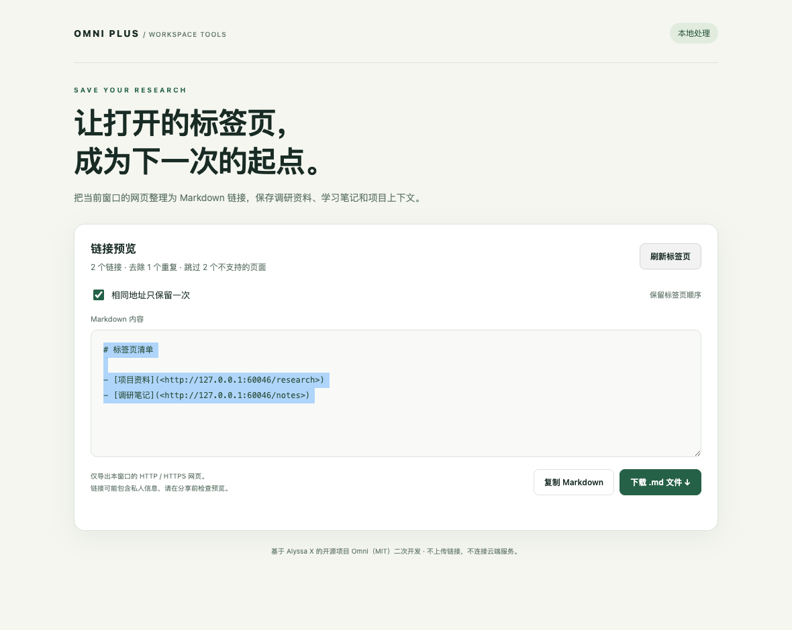

# 页签清单 · 标签页转 Markdown

将当前窗口的网页整理成 Markdown，方便保存调研资料、学习笔记和项目上下文。支持预览、按地址去重、复制和文件下载，不需要服务端或付费 API。

**这是基于 [Alyssa X / Omni](https://github.com/alyssaxuu/omni) 的社区二次开发。** 上游提供命令面板、标签页 / 书签 / 历史管理等核心功能；本仓库新增标签页导出工作流，不将上游代码视为个人原创。原始说明见 [README.upstream.md](README.upstream.md)，原始 MIT 版权与许可见 [LICENSE](LICENSE)。



## 本仓库增加了什么

- 命令面板输入 `Export tabs` 或 `导出标签页`，打开中文导出页面。
- 仅查询发起操作的窗口，按标签页位置排列，默认合并完全相同的 URL；可关闭去重。
- 保留查询参数和片段；跳过浏览器内部页、文件页、无效地址和含用户名 / 密码的 URL。
- 转义 Markdown 标题和 HTML 字符，预览使用只读文本框，不将网页标题插入 HTML。
- 复制失败时选中内容并提示手动复制；支持下载 UTF-8 `.md` 文件、空状态和读取失败提示。
- 修复安装注入与页面自动注入竞争导致的重复命令面板；首次安装打开本地导出页。

导出功能只在本机处理，不上传链接。分享文件前请检查可能含私人内容的标题和地址。原 Omni 仍具有标签页、书签、历史及浏览数据等较广权限；本次改动未新增权限。Firefox 目录保留上游版本，本次新增功能仅实现和验证于 Chromium 的 `src/`。

## 本地加载

1. 下载或克隆本仓库，无需构建或安装运行时依赖。
2. 在 Chrome 打开 `chrome://extensions`，开启“开发者模式”。
3. 点击“加载已解压的扩展程序”，选择仓库的 **`src` 文件夹**。
4. 打开普通网页，按 `⌘⇧K`（macOS）或 `Ctrl⇧K`（Windows），输入 `Export tabs`，选中导出命令。
5. 检查预览后复制或下载；需要更新列表时点击“刷新标签页”。

安装页面不需要本地 Web 服务，没有端口和后台常驻进程。停止使用时在扩展管理页停用或移除；源码目录继续保留。浏览器内部页无法注入命令面板，请从普通网页调用。

## 验证与复现

纯逻辑测试需要 Node.js，运行 `npm test`。浏览器验收需安装开发依赖，然后运行：

```sh
npm install
npx playwright install chromium
npm run test:e2e
```

浏览器测试会启动独立、临时的 Chromium 配置，加载真实 Manifest V3 扩展，只访问合成的本机测试网页；不会读取个人 Chrome 配置。测试覆盖排序、去重切换、跨窗口隔离、真实文件下载字节、模拟复制成功与拒绝后的手动回退、命令入口、空窗口、模拟 API 失败和响应式布局。截图来自合成数据，不是实际浏览记录。具体结果和环境见 [docs/verification.json](docs/verification.json)。

## 代码与面试复习

`background.js` 注册导出命令 → 在同一窗口打开 `export.html` → `export.js` 使用 `chrome.tabs` 获取当前窗口 → `tab-export.js` 过滤、去重和序列化 → 用户复制或下载。

项目取舍、上游与改动的边界、验证局限以及面试复习问题见 [docs/PROJECT.md](docs/PROJECT.md)。实际使用前仍需在个人 Chrome 中加载；独立 Chromium 验收不等于已安装到个人浏览器，也未发布 Chrome 商店。
